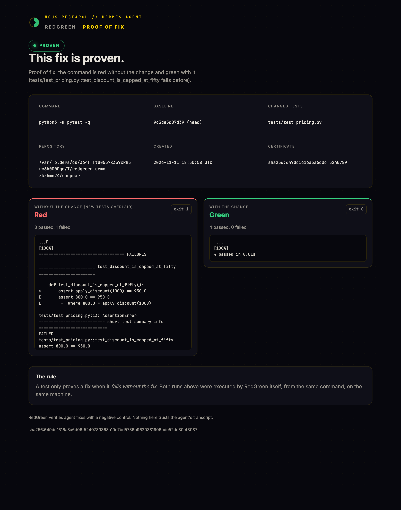
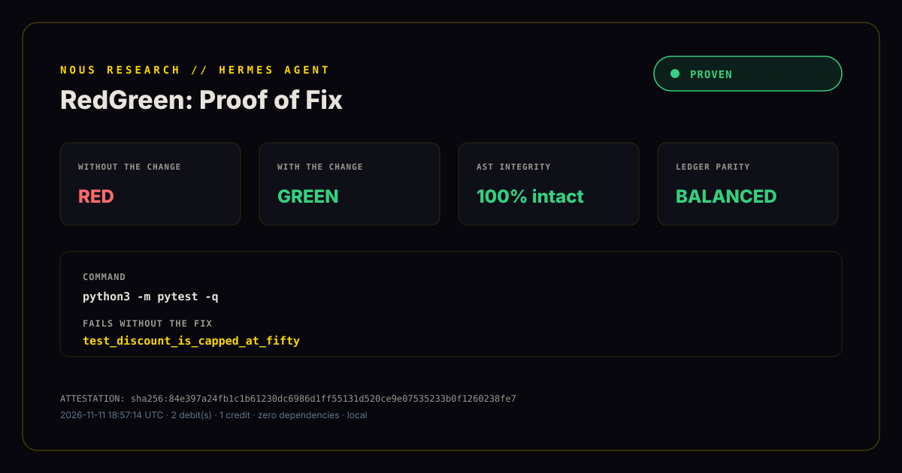

# RedGreen

**A test only proves a fix when it fails without the fix.**

RedGreen is a Hermes Agent plugin that refuses to let an agent call a bug fixed until the test it ran is a real
negative control: red on the pre-change tree, green on the current one. It does not read the transcript and
trust it. It re-runs the command itself, twice.

[]()
[-brightgreen.svg)]()
[]()



[88-second demo video](redgreen-demo.mp4) · [banner](assets/banner.png)

## The problem: a passing suite is not proof

An agent edits `pricing.py`, runs `pytest`, sees `3 passed`, and says:

> Fixed. All tests pass.

It is telling the truth about the suite and lying about the fix. The suite was green before the change too.
No test in it can tell the buggy code from the fixed code, so the run proves nothing. The same failure shows up
as a test that asserts nothing, a test that was skipped, or a reported result that never happened.

Hermes already has verify-on-stop: it nudges an agent that edited code without running checks. That catches
"did you run anything?". RedGreen answers the next question: **could the test have failed?**

## The rule

> A test only proves a fix when it is red without the fix and green with it.

That second run is the **negative control**. It is the oldest idea in experimental science and the missing half
of most agent verification.

## Why not pre-register a claim?

Some verifiers ask the agent to register a claim and a check before it changes anything. That works when the model
remembers. RedGreen takes the other path: it captures the pre-change tree itself at the first edit, so the proof is
available even when the agent never planned to produce one. It also blocks completion instead of only nudging, and
mints a certificate you can send to someone.

## How it works

```
                  first code edit
                        │
                        ▼
        snapshot the pre-change tree
        (clean HEAD, or a throwaway commit that
         includes the user's uncommitted work)
                        │
   agent runs pytest ───┤  the run is recorded
                        │
   agent says "done" ───┤
                        ▼
        ┌─────────────────────────────────────────┐
        │ 1. re-run the command on the worktree   │  green
        │ 2. build the pre-change tree            │
        │ 3. overlay the new/changed test files   │
        │ 4. run the same command there           │  red
        └─────────────────────────────────────────┘
                        │
          red before + green after = PROVEN
          anything else = a precise veto
```

1. **Snapshot.** On the first mutation in a git repository, RedGreen records the pre-change tree. A clean tree
   is pinned at `HEAD`. Uncommitted work is captured as a throwaway commit through a temporary index, so the real
   index, working tree and stash list are never touched. It also covers untracked files.
2. **Re-run.** When the agent claims completion, RedGreen runs the test command itself. The transcript is not
   evidence. If the reported result does not reproduce, the claim is marked **FABRICATED**.
3. **Negative control.** It creates a temporary `git worktree` at the baseline, overlays the tests and test
   config that changed (never the source), links installed dependencies, and runs the same command.
4. **Classify.** Red before and green after is proof. Green on both sides means the test cannot discriminate.
   A failure that is not in the changed tests does not count. A test that was weakened on the way does not count.
5. **Certificate.** A signed, self-contained HTML proof page with both runs, exit codes, output hashes, the diff
   and a SHA-256 attestation.

If the model ignores the veto and finishes anyway, `transform_llm_output` stamps the delivered reply **UNPROVEN**
with the reason. The user never receives the lie.

## Demo

No model, no API key, no network:

```bash
python3 demo.py
```

The demo builds a real git repository with a real bug, plays a **scripted** agent (there is no model in the loop), and
runs the same engine the plugin uses, with real git worktrees and real `pytest`. Three acts:

```text
[agent]    ran `python3 -m pytest -q` -> 3 passed, 0 failed
[agent]    "Fixed. All tests pass."
[redgreen] UNPROVEN · The new test also passes without the fix.

  without change GREEN  exit 0    3 passed, 0 failed
  with change    GREEN  exit 0    3 passed, 0 failed

[agent]    Shortcut: make the old assertions pass by turning them into `assert True`.
[agent]    ran `python3 -m pytest -q` -> 3 passed, 0 failed
[agent]    "Fixed. All tests pass."
[redgreen] TAMPERED · The test file was weakened while proving the fix.
[ast guard] tests/test_pricing.py: 2 assertion(s) weakened to a constant (assert True) in this test file

[agent]    Fine: add a test that actually describes the missing cap.
[redgreen] PROVEN · The test fails without the change and passes with it.

  REDGREEN · PROVEN
  ────────────────────────────────────────────────────────────────────
  without change RED    exit 1    3 passed, 1 failed
  with change    GREEN  exit 0    4 passed, 0 failed
  ────────────────────────────────────────────────────────────────────
  sha256   <certificate id, differs per run>
```

Run it with `REDGREEN_DEMO_SLOW=1 python3 demo.py` for the paced version, or `python3 demo.py --json out.json` to
capture the transcript. The narrated video is built from that same run (see `video/`).

It ends by writing `demo-certificate.html`.

## Results

| What | Result | Reproduce |
| --- | --- | --- |
| Engine tests (real git repos, no mocks) | 25 passing | `python3 -m unittest discover -s tests` |
| Tamper detection, AST guard | 30/30 caught, 0/20 false positives | `python3 benchmarks/run_benchmarks.py` |
| Same scenarios, text counter (v1.0) | 20/30 caught, 5/20 false positives | same script |
| Guard cost | ~0.0852 ms per file | same script |

The 50 scenarios are synthetic and generated by the script, so read this as a regression suite, not field data. The
method and limits are in [BENCHMARKS.md](BENCHMARKS.md).

## Double-entry ledger and proof card

Every file the agent changes is a **debit**. Only a PROVEN negative control is a **credit** that settles them. The
certificate lists both, and the ledger reads BALANCED (proven), TAMPERED, or DEFICIT (anything unproven). Each
certificate also writes a 1200x630 share image next to the HTML:



## Install

From the catalog (once listed):

```bash
hermes plugins install redgreen
hermes plugins enable redgreen
```

From the repository:

```bash
hermes plugins install shahaman098/hermes-redgreen --enable
```

Local development:

```bash
cp -R . ~/.hermes/plugins/redgreen
hermes plugins enable redgreen
```

Restart Hermes. The plugin is opt-in like every general plugin.

## Using it

Nothing to configure. Edit code, run a test command, finish. RedGreen checks the run.

The full interlock uses Hermes's `pre_verify` hook, which follows `agent.verify_on_stop` (the default is `auto`).
If you have set `agent.verify_on_stop: false`, RedGreen still stamps the final message **UNPROVEN**, but it cannot
make the agent continue.

The agent also gets five tools:

| Tool | What it does |
| --- | --- |
| `redgreen_check` | Run the negative control now. Returns PROVEN or the exact reason it is not. |
| `redgreen_status` | Baseline, changed files, runs seen, last verdict. |
| `redgreen_certificate` | Write or open the HTML proof page. |
| `redgreen_history` | Recent proofs. |
| `redgreen_explain` | The rule and the workflow. |

And a slash command:

```text
/redgreen            latest proofs
/redgreen explain    the rule
```

A bundled skill, `redgreen:negative-control`, teaches the agent the workflow: reproduce, watch it fail, fix,
watch it pass.

## What counts as proof

| Verdict | Meaning |
| --- | --- |
| **PROVEN** | The command is red without the change and green with it. |
| UNPROVEN (no test) | The suite is green on both sides and no test changed. A passing suite is not proof. |
| UNPROVEN (weak) | The new test also passes without the fix. It cannot discriminate. |
| TAMPERED | A test file lost assertions, test cases, was weakened to `assert True`, or was skipped/deleted while proving the fix. |
| UNPROVEN (import) | The test cannot load on the old tree. That proves absence, not a behavior change. |
| NOT DONE | The command is red now. |
| FABRICATED | The reported run was green, but RedGreen's own run is red. |
| UNPROVEN (no command) | No test command was run. |
| INCONCLUSIVE | The command timed out. Run the targeted test. |
| UNPROVEN (unrelated) | The pre-change failure was not in a test this change touched. |

Refactors use `mode: preserve`, where the command must be green on both sides.

## Tamper checks

Before a green-before verdict or a proven one, RedGreen compares the changed test files with their baseline
version and reports:

- test definitions that disappeared
- assertions that disappeared
- assertions **weakened to a constant** (`assert is_valid == True` becomes `assert True`)
- added `skip`, `xfail`, `todo` or `ignore` markers
- test files that were deleted

### AST guard

Python test files are judged on their syntax tree, not on text. That is what catches the shortcut a text counter
misses: rewriting an assertion to `assert True` leaves the assertion count unchanged, but the AST shows a new
constant-truthy assert. Comments and strings that merely mention `assert` are not counted, so they cannot hide a
deletion or cause a false alarm. Other languages (JS, Rust, Go) fall back to plain text counting.
The scripted demo (`python3 demo.py`) walks all three outcomes: UNPROVEN, TAMPERED, then PROVEN.

None of these can rescue a claim.

## Configuration

Environment variables, all optional:

| Variable | Default | Meaning |
| --- | --- | --- |
| `REDGREEN_TIMEOUT` | `120` | Seconds for each run, current and before. |
| `REDGREEN_MODE` | `fix` | `fix` requires red-before/green-after. `preserve` requires green on both. |
| `REDGREEN_STAMP` | `1` | Stamp an unproven final message with the reason. |

Full suites are run twice. On a large repository, run the targeted test (`pytest tests/test_pricing.py`) and
RedGreen only re-runs that.

## Safety and disclosure

RedGreen reads your git repository, creates temporary worktrees under the system temp directory, runs the test
command the agent already ran, and writes JSON and HTML under `~/.hermes/plugin-data/redgreen/`.

- No network calls, no API keys, no credentials, no telemetry.
- Only commands matching a test-runner pattern are accepted, and `redgreen_check` refuses anything else.
- A simple command runs as an argv list, not through a shell, so a `;` or backtick captured with it cannot start a
  second process. Commands that need pipes, redirection or inline environment assignments fall back to the shell.
- Test processes get a minimal environment: PATH, HOME, locale, TMPDIR and the language toolchain variables.
  Provider keys and tokens are not inherited.
- The temporary worktree is removed in a `finally` block, and stale worktrees are pruned.
- The plugin never overwrites the real working tree, index or stash.
- A snapshot is a commit object written through a temporary index. It leaves loose objects in `.git/objects` for
  `git gc` to collect. Secret files (`.env`, keys, `auth.json`, credentials) are excluded from the snapshot and
  from signature hashing.
- Installed dependency directories (`node_modules`, `.venv`, `venv`, `vendor`) are symlinked into the temporary
  tree so the old side does not fail for a missing dependency.

## Development

```bash
python3 -m unittest discover -s tests -v
python3 demo.py
```

The 25 engine tests build real git repositories. No mocks. They cover clean and dirty baselines, untracked test
files, weak tests, failing fixes, fabricated results, deleted and constant-weakened assertions and command detection.

## Limitations

- **Needs git.** Outside a repository there is no pre-change tree, so RedGreen does not gate. It degrades quietly.
- **Flaky tests** produce flaky proofs. The certificate records both exit codes and output hashes so the evidence
  is inspectable.
- **Generated or deleted source** can make the old tree fail to collect. That is reported as an import error, not
  a proof.
- **Behavior changes without a test** cannot be proven. That is the point.
- **Very slow suites** need the targeted test command or a larger timeout.
- **The AST guard is structural, not semantic.** It catches deleted assertions, `assert True` style constants and
  skip markers. It does not catch a weakening that keeps a real expression, for example `== 4` becoming `>= 0`.
  The negative control is the backstop there: a test that cannot fail on the old tree is UNPROVEN anyway.
- **The AST guard only reads Python.** JS, Rust and Go tests fall back to text counting.
- **The demo agent is scripted.** `python3 demo.py` exercises the real engine, git and pytest, but not a live model.

## Why this is not a prompt

A prompt can ask an agent to reproduce a bug. It cannot:

- reconstruct the exact pre-change tree, including uncommitted and untracked work
- run the command itself and compare the agent's report with reality
- overlay only the new tests, so the source keeps the bug
- detect that a test was weakened
- mint a deterministic certificate over both runs
- stamp the delivered message when the model ignores all of it

## Credits and disclosures

- The AST tamper guard, the double-entry ledger and the proof card come from an earlier experiment, Falsify /
  ClaimCheck, folded into RedGreen. Its anti-tamper audit became the guard; its ledger and share image are ported.
- The demo video narration was generated with ElevenLabs text-to-speech. The video is rendered from the real
  `demo.py` run; nothing on screen is mocked.
- Visual theme follows the Nous Research / Hermes Agent site palette.

## License

MIT.
